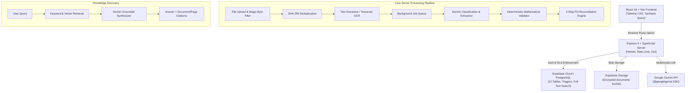

# DocuMind AI — Enterprise Intelligent Document Processing (IDP) & Knowledge Discovery Platform

[](https://www.typescriptlang.org/)
[](https://reactjs.org/)
[](https://vitejs.dev/)
[](https://nodejs.org/)
[](https://tailwindcss.com/)
[](https://supabase.com/)
[](https://ai.google.dev/)
[](#testing)

**DocuMind AI** is an enterprise-grade Intelligent Document Processing (IDP) and cross-document Knowledge Discovery platform. It transforms unstructured business documents (Invoices, Purchase Orders, Master Services Agreements, Receipts, Compliance Reports) into structured, mathematically validated, audited data records with grounded provenance, automated 2-way reconciliation, and conversational knowledge exploration.

---

## 📑 Table of Contents

- [Key Capabilities](#-key-capabilities)
- [System Architecture](#-system-architecture)
- [Repository Structure](#-repository-structure)
- [Tech Stack](#-tech-stack)
- [Getting Started](#-getting-started)
  - [Prerequisites](#prerequisites)
  - [Installation](#installation)
  - [Environment Variables](#environment-variables)
  - [Database & Storage Setup](#database--storage-setup)
  - [Running the Applications](#running-the-applications)
- [End-to-End Processing Pipeline](#-end-to-end-processing-pipeline)
- [Reconciliation Engine (2-Way Invoice vs PO)](#-reconciliation-engine-2-way-invoice-vs-po)
- [Knowledge Discovery & Grounded Q&A](#-knowledge-discovery--grounded-qa)
- [Security & Multi-Tenant Isolation](#-security--multi-tenant-isolation)
- [Testing](#-testing)
- [API Documentation](#-api-documentation)
- [Documentation Directory](#-documentation-directory)

---

## 🌟 Key Capabilities

1. **Intelligent Ingestion & OCR:**
   - Multi-format ingestion (`.pdf`, `.png`, `.jpg`, `.jpeg`, `.tiff`, `.docx`).
   - Magic byte header inspection preventing extension spoofing.
   - SHA-256 content hashing for automatic duplicate detection and idempotency.
   - Dual-engine OCR: native vector text extraction via `pdf-parse` / `mammoth` with optical OCR via `tesseract.js` for scanned media.

2. **Multimodal Gemini AI Extraction:**
   - Powered by official `@google/genai` SDK (`gemini-1.5-flash` / `gemini-1.5-pro`).
   - Strict JSON-schema output enforcing structured entities, field confidence scores ($0.00-1.00$), and bounding box / line evidence provenance.
   - Dynamic classification across Invoices, Purchase Orders, Contracts, Receipts, Tax Filings, and General Business Documents.

3. **Deterministic Mathematical & Domain Validation:**
   - Precise decimal arithmetic with zero floating-point drift.
   - Automated reconciliation: $\sum (\text{item.quantity} \times \text{item.unit\_price}) \stackrel{?}{=} \text{item.amount}$.
   - Subtotal reconciliation: $\text{subtotal} + \text{tax} + \text{shipping} - \text{discount} \stackrel{?}{=} \text{total\_amount}$.
   - Date sequencing verification ($\text{due\_date} \ge \text{issue\_date}$) and required vendor/field presence.

4. **Human-in-the-Loop Review Workspace:**
   - Side-by-side synchronized document viewport and extracted data editor.
   - Confidence-coded field inputs (Green $\ge 90\%$, Yellow $70-89\%$, Red $< 70\%$).
   - Interactive bounding-box overlays highlighting exact textual origins.
   - Approval workflows (`approved`, `rejected`, `needs_review`) with complete audit trail logging.

5. **2-Way Invoice vs Purchase Order Reconciliation Engine:**
   - Cross-document matching pairing invoices with their corresponding purchase orders.
   - Deterministic matching by vendor name, PO reference, and currency.
   - Line-item pairing with configurable quantity/price variance tolerance ($\pm 2\%$).
   - Automated discrepancy tagging (`PRICE_MISMATCH`, `QUANTITY_OVERBILL`, `MISSING_LINE_ITEM`, `TAX_DISCREPANCY`).

6. **Cross-Document Knowledge Discovery:**
   - Multi-document semantic search and synthesis.
   - Grounded citations citing document ID, title, and exact page numbers.
   - Zero-hallucination policy declaring lack of context when answers are ungrounded.

7. **Enterprise Security & Formula Injection Defense:**
   - Supabase Row Level Security (RLS) enforcing strict multi-tenant boundary separation.
   - Role-Based Access Control: `owner`, `admin`, `reviewer`, `member`.
   - CSV/Excel Export sanitization: prepending single quotes `'` to formulas starting with `=`, `+`, `-`, `@`, `\t`, `\r` to defeat CSV injection (CWE-1236).
   - Rate limiting, Helmet security headers, CORS isolation, and correlation ID tracing.

---

## 🏛 System Architecture



---

## 📁 Repository Structure (Separated Frontend & Backend)

```
phoenix/
├── backend/                            # Standalone Express API & AI Pipeline
│   ├── .env                            # Active backend environment configuration
│   ├── .env.example                    # Template for backend environment variables
│   ├── package.json                    # Backend dependencies & npm scripts
│   ├── tsconfig.json                   # TypeScript configuration
│   ├── src/
│   │   ├── ai/                         # Gemini client and schema prompts
│   │   ├── config/                     # Environment & Supabase initialization
│   │   ├── controllers/                # REST API route controllers
│   │   ├── middleware/                 # Auth, RLS, validation, security
│   │   ├── repositories/               # Supabase & resilient in-memory database
│   │   ├── routes/                     # Express API router (20+ endpoints)
│   │   ├── services/                   # OCR, extraction, validation, reconciliation, export
│   │   ├── shared/                     # Self-contained domain types & Zod schemas
│   │   ├── utils/                      # Decimal math, logger, file signatures
│   │   └── workers/                    # Background job queue processor
│   └── tests/                          # Integration & unit test suite (26 tests)
│
├── frontend/                           # Standalone React 18 SPA (Vite + Tailwind CSS)
│   ├── .env                            # Active frontend environment configuration
│   ├── .env.example                    # Template for frontend environment variables
│   ├── package.json                    # Frontend dependencies & npm scripts
│   ├── vite.config.ts                  # Vite bundler & reverse proxy configuration
│   ├── src/
│   │   ├── components/                 # Reusable UI primitives, Navigation, Layout
│   │   ├── context/                    # Auth & active organization state
│   │   ├── lib/                        # API client with correlation IDs
│   │   ├── shared/                     # Self-contained domain types & Zod schemas
│   │   └── pages/                      # 14 complete production views
│   │       ├── LandingPage.tsx         # Hero, features, interactive ROI calculator
│   │       ├── DashboardPage.tsx       # Processing metrics & recent activities
│   │       ├── DocumentsPage.tsx       # Filterable document catalog
│   │       ├── UploadPage.tsx          # Drag-and-drop & pre-canned document demos
│   │       ├── DocumentDetailPage.tsx  # Extracted metadata & line items
│   │       ├── ReviewPage.tsx          # Side-by-side human-in-the-loop workspace
│   │       ├── ReconciliationPage.tsx  # Invoice vs PO 2-way match engine
│   │       ├── KnowledgePage.tsx       # Cross-document Q&A with citations
│   │       ├── JobsPage.tsx            # Pipeline job queue & step telemetry
│   │       ├── ReportsPage.tsx         # CSV / JSON export with injection safety
│   │       ├── TeamPage.tsx            # Role-based member management
│   │       ├── SettingsPage.tsx        # Organization configuration & API keys
│   │       └── AuditPage.tsx           # Immutable security audit log
│   └── tests/                          # Web UI unit test suite (7 tests)
│
├── supabase/
│   ├── migrations/
│   │   └── 20261015000001_init_all_tables.sql  # Single-run master migration (all 12 tables, RLS, functions & seed)
│   ├── supabase.sql                    # SQL Editor single-run copy-paste master script
│   └── seed.sql                        # Standalone synthetic dataset (Apex Logistics)
│
└── docs/                               # Deep technical documentation
    ├── architecture.md                 # System design & data flow
    ├── api.md                          # REST API endpoint reference
    ├── security.md                     # RLS, formula injection & auth design
    └── demo-script.md                  # Step-by-step evaluator testing guide
```

---

## 🛠 Tech Stack

| Layer | Technology | Purpose |
|---|---|---|
| **Frontend Framework** | React 18, Vite 6, TypeScript 5.7 | Fast SPA development with instant HMR |
| **Styling & UI** | Tailwind CSS 3.4, Lucide React Icons | Modern, high-density enterprise dashboard design |
| **State & Data Fetching** | TanStack Query v5 | Server state caching, optimistic updates, polling |
| **Backend API** | Node.js 20+, Express 4, TypeScript | Modular, scalable RESTful API |
| **Database & Auth** | Supabase (PostgreSQL 15), Row Level Security | Multi-tenant data isolation & secure file storage |
| **AI / Multimodal LLM** | Google Gemini 1.5 Flash (`@google/genai` official SDK) | Document classification, extraction, reasoning |
| **OCR & Document Parsing** | `pdf-parse`, `mammoth`, `tesseract.js` | Dual digital text extraction & optical fallback |
| **Math & Validation** | `decimal.js`, Zod 3 | Accurate financial arithmetic and runtime schema validation |
| **Testing** | Vitest 3, Supertest | Unit, mathematical, security, and integration tests |

---

## 🚀 Getting Started

### Prerequisites

- **Node.js**: v18.0.0 or later (v20+ recommended)
- **npm**: v9.0.0 or later

### Installation

Frontend and Backend can be installed completely independently:

```bash
# Install backend dependencies
cd backend
npm install

# Install frontend dependencies
cd ../frontend
npm install
```

---

## 🔐 Environment Files Setup

The project uses distinct, separated `.env` files for frontend and backend:

### 1. Backend Environment (`backend/.env`)

```bash
cp backend/.env.example backend/.env
```

Key variables configured in `backend/.env`:
```ini
PORT=4000
NODE_ENV=development
API_BASE_PATH=/api/v1
FRONTEND_URL=http://localhost:5173
ENABLE_DEMO_MODE=true

# Optional: Add your Gemini API Key for live AI extraction
GEMINI_API_KEY=your_gemini_api_key_here
GEMINI_MODEL=gemini-1.5-flash

# Optional: Add your Supabase credentials for cloud persistence
SUPABASE_URL=https://your-project.supabase.co
SUPABASE_ANON_KEY=your_anon_key
SUPABASE_SERVICE_ROLE_KEY=your_service_role_key
```

### 2. Frontend Environment (`frontend/.env`)

```bash
cp frontend/.env.example frontend/.env
```

Key variables configured in `frontend/.env`:
```ini
# Backend API Base URL
VITE_API_URL=/api/v1

# Branding & App Mode
VITE_APP_NAME="DocuMind AI"
VITE_ENABLE_DEMO_ACCOUNTS=true
```

> **Note on Demo Mode:** DocuMind AI includes a full in-memory fallback store pre-seeded with enterprise documents, reconciliations, and knowledge records. If Supabase or Gemini keys are omitted, the application runs fully functional out of the box with realistic synthetic AI processing.

### Database & Storage Setup (Supabase)

If deploying with Supabase Cloud or a local Supabase instance, everything runs in a **single run**:

#### Option 1: Supabase Web Dashboard (Recommended)
1. Open your Supabase project dashboard -> **SQL Editor**.
2. Copy the entire contents of [`supabase/supabase.sql`](file:///c:/Users/VENKATA%20SAI%20RAM/Desktop/phoenix/supabase/supabase.sql).
3. Paste and click **RUN**.
   - This creates all 12 tables, indexes, automatic triggers, RLS policies, storage bucket, and pre-seeds the demo dataset in a single execution.

#### Option 2: Supabase CLI / psql
Apply the single master migration:
```bash
cat supabase/migrations/20261015000001_init_all_tables.sql | psql "$SUPABASE_DB_URL"
```

### Running the Applications

#### Option A: Run Standalone in Separate Terminals (Recommended)

```bash
# Terminal 1: Start Backend API (Port 4000)
cd backend
npm run dev

# Terminal 2: Start Frontend Web Client (Port 5173)
cd frontend
npm run dev
```

#### Option B: Run from the Root Directory

```bash
npm run dev:backend    # Starts backend at http://localhost:4000
npm run dev:frontend   # Starts frontend at http://localhost:5173

# Option 2: Start independently in separate terminals
npm run dev:server   # Starts Express API at http://localhost:4000
npm run dev:web      # Starts Vite React client at http://localhost:5173
```

Open your browser at **`http://localhost:5173`**.

---

## 🔄 End-to-End Processing Pipeline

1. **Upload & Ingestion:**
   User uploads a file. The server validates magic bytes (`%PDF`, `PK\x03\x04`, `\xFF\xD8\xFF`, etc.) and generates a SHA-256 fingerprint. If a duplicate is detected within the tenant, the user is immediately alerted.
2. **Text & OCR Extraction:**
   Text is extracted natively via `pdf-parse` or optical OCR via `tesseract.js` for images. Extracted text is segmented into numbered page objects with character spans.
3. **Gemini Extraction:**
   The text payload is delivered to Gemini with a strictly typed JSON schema for the detected document type. Gemini returns normalized key-value fields, line items, confidence scores, and bounding-box coordinates.
4. **Deterministic Validation:**
   The server performs line-by-line decimal recalculation:
   - Line subtotal match
   - Tax rate calculation verification
   - Invoice grand total verification
   - Issue/due date ordering
   - Missing mandatory fields
5. **Human Review:**
   Documents with low confidence (< 85%) or validation errors are flagged for human review. Reviewers inspect highlighted bounding boxes and correct values before final sign-off.
6. **Export & Integration:**
   Validated documents are exported safely to CSV or JSON with built-in formula injection defenses.

---

## ⚖️ Reconciliation Engine (2-Way Invoice vs PO)

DocuMind AI provides automated 2-way document matching:

1. **Document Pairing:** Select an Invoice and a corresponding Purchase Order.
2. **Deterministic & Semantic Pairing:** The engine matches headers (Vendor, Currency, PO Reference) and pairs line items using description similarity and SKU heuristics.
3. **Variance Evaluation:**
   - **Quantity Variance:** Flags overbilled or under-delivered quantities.
   - **Unit Price Variance:** Detects unauthorized price hikes exceeding the configured tolerance (default 2%).
   - **Unmatched Items:** Identifies surprise items billed on invoice that were never authorized on the PO.
4. **Interactive Resolution:** Approvers can view side-by-side discrepancies and mark items as matched, disputed, or approved with notes.

---

## 🔍 Knowledge Discovery & Grounded Q&A

Ask complex analytical questions across all processed documents:
- *"Which vendors increased software subscription rates this quarter?"*
- *"What is our total outstanding liability across unapproved invoices?"*
- *"What are the termination notice requirements across our active vendor agreements?"*

Every answer includes:
- Grounded synthesized explanation.
- Clickable document citations with title, document ID, and page references.
- Relevant source text excerpts.
- Strict fallback when documents do not contain sufficient evidence.

---

## 🔒 Security & Multi-Tenant Isolation

- **Supabase Row Level Security (RLS):** All 12 tables implement strict tenant boundaries via `organization_id = auth.jwt() ->> 'organization_id'`.
- **Role Permissions:** Granular permissions enforced at both database and API middleware levels:
  - `owner`: Full organization, billing, and team deletion control.
  - `admin`: Document upload, review, user invite, and export access.
  - `reviewer`: Document viewing, field correction, and approval workflows.
  - `member`: Read-only access to approved documents and search.
- **Formula Injection Defense:** All spreadsheet exports sanitize fields starting with `=`, `+`, `-`, `@`, `\t`, `\r` by escaping them with a leading apostrophe `'`.
- **Audit Logging:** Every critical action (upload, field edit, review sign-off, user change) is recorded immutably with user ID, timestamp, IP, and state diffs.

---

## 🧪 Testing

The repository includes a comprehensive automated test suite covering unit math, schema validation, API routes, security boundaries, and formula injection defenses.

Run all tests across all monorepo packages:

```bash
npm test
```

Run test suites individually:

```bash
npm test --workspace=@documind/shared   # Validates shared Zod schemas (5 tests)
npm test --workspace=@documind/server   # API integration, validation & security (21 tests)
npm test --workspace=@documind/web      # Web UI unit tests (2 tests)
```

---

## 📡 API Documentation

| Method | Endpoint | Description | Required Role |
|---|---|---|---|
| `POST` | `/api/v1/auth/login` | Authenticate and obtain JWT token | Public |
| `GET` | `/api/v1/organizations` | List organizations for active user | `member` |
| `GET` | `/api/v1/dashboard/summary` | Retrieve processing stats and metrics | `member` |
| `GET` | `/api/v1/documents` | List documents with filtering and search | `member` |
| `POST` | `/api/v1/documents/upload` | Upload new document with magic-byte check | `reviewer` |
| `GET` | `/api/v1/documents/:id` | Get full document details and pages | `member` |
| `GET` | `/api/v1/documents/:id/extractions` | Get extracted fields and line items | `member` |
| `PATCH` | `/api/v1/documents/:id/extractions` | Update extracted field (Human-in-the-loop) | `reviewer` |
| `POST` | `/api/v1/documents/:id/review` | Submit review decision (approve/reject) | `reviewer` |
| `POST` | `/api/v1/reconciliations/match` | Perform 2-way Invoice vs PO match | `reviewer` |
| `POST` | `/api/v1/knowledge/ask` | Grounded cross-document Q&A with citations | `member` |
| `POST` | `/api/v1/exports/csv` | Secure CSV export with formula injection safety | `member` |
| `GET` | `/api/v1/audit/logs` | Fetch immutable audit trail | `admin` |

For detailed request/response payloads, see [`docs/api.md`](docs/api.md).

---

## 📚 Documentation Directory

- 📐 [Architecture & Data Flow Guide](docs/architecture.md)
- 🔌 [Complete REST API Specification](docs/api.md)
- 🛡️ [Security, RLS & Hardening Guidelines](docs/security.md)
- 🎬 [Interactive Evaluator Demo Walkthrough](docs/demo-script.md)

---

## 📄 License

Licensed under the MIT License. Copyright © 2026 DocuMind AI.
