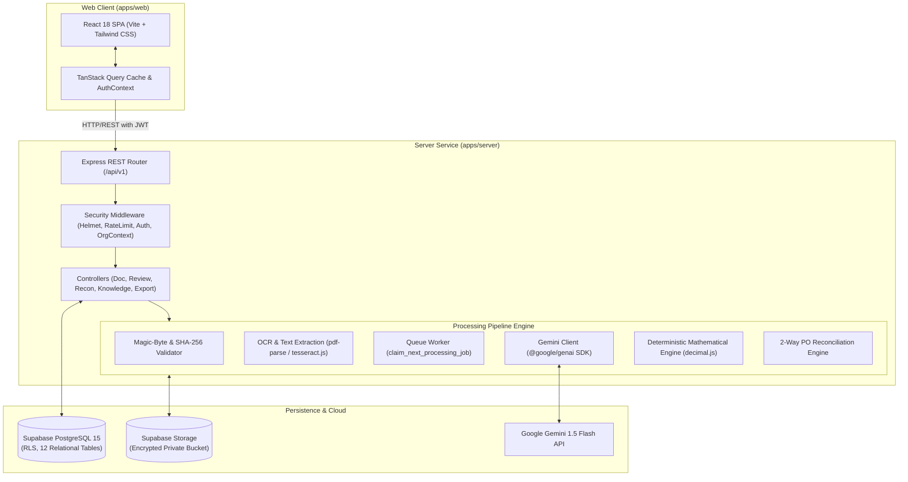
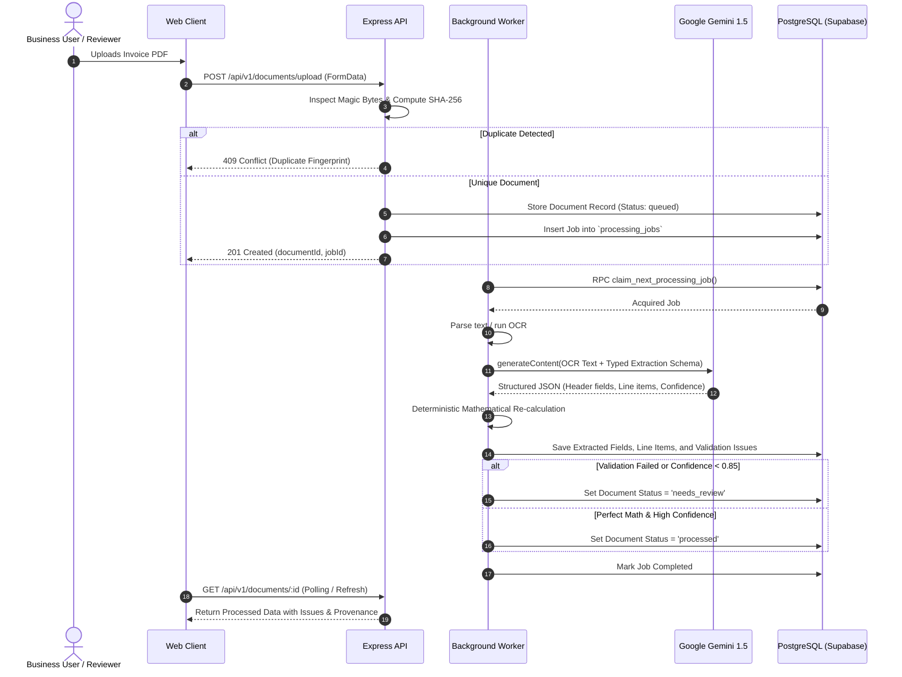

# DocuMind AI — System Architecture & Design Specification

## 1. Executive Summary

DocuMind AI is architected as a modular, decoupled, event-driven Intelligent Document Processing (IDP) and cross-document Knowledge Discovery platform. The system operates as two standalone, decoupled applications:
- `backend/`: Node.js/Express API service with background worker queues, Gemini AI connectors (`@google/genai`), deterministic financial calculators, and OCR parsing engines.
- `frontend/`: React 18 Single Page Application built on Vite, Tailwind CSS, and TanStack Query.

---

## 2. High-Level Architecture Diagram

---

## 3. Ingestion & Extraction Pipeline Flow

The document processing lifecycle progresses through five explicit states: `uploaded` $\to$ `queued` $\to$ `processing` $\to$ `needs_review` / `processed` $\to$ `approved` / `rejected`.

---

## 4. Deterministic Financial Math Engine

A core design principle of DocuMind AI is **never trusting LLM arithmetic for financial computations**. The system implements deterministic verification via `decimal.js`:

1. **Line-Item Arithmetic:**
   $$\forall i \in \text{Items},\quad |\text{quantity}_i \times \text{unit\_price}_i - \text{amount}_i| \le 0.01$$
2. **Subtotal Reconciliation:**
   $$\left|\sum_{i} \text{amount}_i - \text{subtotal}\right| \le 0.01$$
3. **Grand Total Balance:**
   $$|\text{subtotal} + \text{tax} + \text{shipping} - \text{discount} - \text{total\_amount}| \le 0.01$$
4. **Chronological Validity:**
   $$\text{issue\_date} \le \text{due\_date}$$

If any arithmetic fails, an issue record is written to `validation_issues` with severity `error`, immediately triggering human review.

---

## 5. 2-Way Invoice vs Purchase Order Reconciliation Engine

The reconciliation engine matches accounts payable invoices against approved purchase orders:
- **Header Matching:** Compares vendor tax IDs, normalized vendor names, and purchase order references.
- **Line-Item Association:** Matches line items by description fuzzy token similarity and product codes.
- **Quantity Variance:** Flags overbilling ($Q_{\text{invoice}} > Q_{\text{PO}}$).
- **Unit Price Variance:** Calculates variance percentage:
  $$\Delta P = \frac{|P_{\text{invoice}} - P_{\text{PO}}|}{P_{\text{PO}}} \times 100\%$$
  Discrepancies exceeding $2.0\%$ are tagged with `PRICE_MISMATCH`.
- **Surprise Items:** Line items on an invoice with no counterpart on the PO are marked `MISSING_LINE_ITEM`.

---

## 6. Grounded Cross-Document Knowledge Discovery

DocuMind AI enables enterprise semantic search across all processed document texts and extracted fields:
- Queries execute against tokenized full-text search indexes (`tsvector`) and metadata filters.
- Retrieved passages are bundled with strict grounding prompts to Gemini.
- Gemini synthesizes the answer with mandatory inline citation references: `[Doc: <title>, Page: <page_number>]`.
- If the requested information is absent or ambiguous, the model returns a zero-hallucination notice stating that the knowledge is unverified in the available corpus.
